<div align="center">

<a href="#"></a>

<br />

[](https://www.linkedin.com/in/amir-ghaderin)
[](mailto:it.ghaderian@gmail.com)

</div>

## About

Frontend developer with **5+ years** of experience shipping production web apps with **React, Next.js and TypeScript**. I build interfaces that load fast, scale with the product and stay easy to maintain.

## Stack

<p align="center">
  <a href="#"></a>
</p>

```ts
const stack = {
  core:    ["React", "Next.js", "TypeScript"],
  state:   ["Redux Toolkit", "RTK Query", "React Query", "Zustand"],
  ui:      ["Tailwind CSS", "shadcn/ui", "Framer Motion"],
  forms:   ["React Hook Form", "Zod"],
  testing: ["Jest", "Vitest", "Storybook"],
  tooling: ["Vite", "Webpack", "ESLint", "Husky"],
} as const;
```

## Focus

| | |
| --- | --- |
| **Performance** | Fast first loads, smooth interactions, small bundles |
| **Architecture** | Typed, reusable components and predictable state |
| **PWA** | Installable apps that keep working on weak connections |